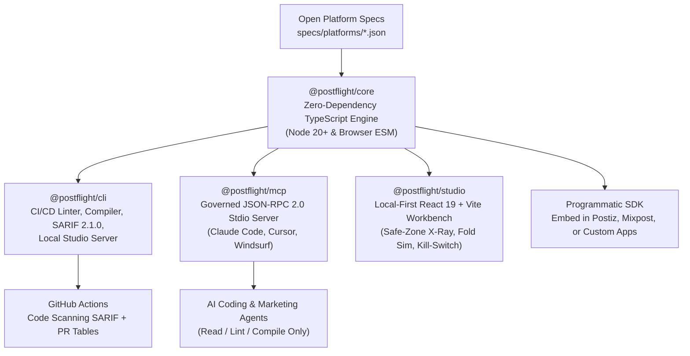

# PostFlight Architecture

PostFlight is designed around a **deterministic-first, zero-API-key, quad-surface architecture**: one zero-dependency TypeScript core engine powers an open data registry, a CI-ready CLI, a governed Model Context Protocol (MCP) server, and a local-first interactive Web Studio.

## Core Design Principles

### 1. Zero-API-Key Day-1 Value
Existing self-hosted social schedulers require weeks of Meta App Review, TikTok `SELF_ONLY` audit workarounds, and paid X API tiers before delivering value. PostFlight decouples **content engineering & pre-flight validation** from **delivery transport**: every linter rule, fold simulator, safe-zone collision check, FFmpeg pipeline, UTM auditor, comment triager, and canonical compiler runs locally in milliseconds with zero external API keys.

### 2. Browser + Node Parity (`@postflight/core`)
`@postflight/core` has **zero runtime npm dependencies** and uses **zero Node-only built-ins** (no `node:fs`, no `node:crypto`). Standard platform primitives (`Intl.Segmenter`, `TextEncoder`, `URL`) plus a pure-TypeScript FIPS 180-4 SHA-256 implementation power both server-side CI/MCP pipelines and offline client-side Web Studio execution.

### 3. Open Specs as Data (`specs/platforms/*.json`)
Platform limits change constantly (Instagram cutting hashtags from 30 to 5 in Dec 2025, shifting profile grids to 3:4, Bluesky enforcing 2,000,000 decimal bytes). Every platform spec is defined in versioned JSON validated by `specs/schema.json` and locked to `@postflight/core` via automated parity tests (`specs-sync.test.mjs`).

### 4. Fail-Closed Governance for Agents & Agencies
- **Governed MCP Surface**: `@postflight/mcp` exposes 9 deterministic validation, compilation, safe-zone, media, and triage tools—intentionally excluding live publishing credentials so autonomous agents cannot ship broken or non-compliant brand posts.
- **Tamper-Evident Crisis Kill-Switch**: `packages/core/src/governance/killswitch.ts` maintains a SHA-256 hash-chained audit ledger (`prevHash -> sha256(canonicalEntry)`) so emergency freezes, approvals, and blocked publish attempts are cryptographically verifiable.

## Module Breakdown (`packages/core/src`)

| Module | Responsibility |
| :--- | :--- |
| `specs/registry.ts` | Versioned specs for 9 platforms + runtime extensibility (`registerPlatformSpec`) |
| `counters/index.ts` | X `twitter-text` weighted (`t.co=23`), Bluesky dual grapheme/UTF-8 bytes + exact UTF-8 facets, Threads emoji UTF-8 weight, Mastodon domain-stripped handles + CW, TikTok API vs native divergence |
| `fold/simulator.ts` | Mobile & Desktop `"See more"` truncation simulator including LinkedIn's blank-line fold penalty |
| `linter/rules.ts` | 77 deterministic lint rules across Limits, Fold, Algorithm, Compliance (FTC/ASA/AI), Accessibility (WCAG), Media/OG, UTM, and Brand Guardrails |
| `linter/autofix.ts` | Deterministic 1-click Auto-Fixer (Unicode faux-bold -> ASCII, PascalCase hashtags, cap trimming, FTC upfront disclosure, UTM cleanup) |
| `linter/index.ts` | Scoring engine (0–100, A+–F) and SARIF 2.1.0 serializer for GitHub Code Scanning |
| `safezone/analyzer.ts` | Exact 2D dead-zone & lower-right notch collision engine across 16 presets (9:16 Organic/Ad, IG 4:5->3:4 grid, LinkedIn PDF, X multi-grids) |
| `compiler/canonical.ts` | Zero-dep Markdown/YAML frontmatter parser + 1-to-N native platform compiler (X threads, Bluesky UTF-8 facets, IG DM funnel) |
| `media/validator.ts` | Media spec validator (Bluesky decimal 2M byte cap, IG Graph API Error 36003, C2PA AI-label warning, watermarks), OG card validator (WhatsApp 300 KB drop), WCAG 2.2 contrast calculator |
| `media/ffmpeg.ts` | Platform-calibrated FFmpeg Rec.709 SDR / CFR / `yuv420p` / `faststart` / `-14 LUFS` command builder |
| `attribution/utm.ts` | Dark-social UTM hygiene auditor, click-ID stripper, canonical URL builder |
| `intelligence/duplicate.ts` | Exact hash + Jaccard shingle duplicate detector + LinkedIn 24-hour cannibalization window |
| `intelligence/triage.ts` | High-intent buyer / P0 crisis / support / feedback / bot-noise classifier with Meta 24h & FINRA alerts |
| `intelligence/tokens.ts` | OAuth token decay monitor (Meta 60d/24h window, LinkedIn 60d non-partner, X 2h RFC 9700 race, TikTok 24h unaudited lock) |
| `governance/killswitch.ts` | Global Crisis Kill-Switch state machine + pure-TS SHA-256 hash-chained audit ledger |
